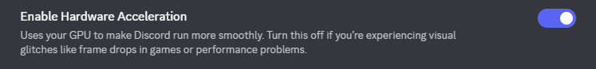

# Discord overlay

Ascendency draws through Discord’s **new Game Overlay**. If that overlay is off or legacy overlay is still on, the menu will not show.


Use the Discord **desktop** app. The browser client has no overlay.




### Open Discord settings

In the desktop app, click the **gear** next to your username (bottom left).



### Game Overlay

In the left sidebar, open **Game Overlay** and set it like this:

| Setting | Value |
| --- | --- |
| Enable Overlay | **On** |
| Enable Legacy Overlay | **Off** |
| Your game (e.g. Rob Run) | Overlay **on** for that title |

<figure><figcaption>Game Overlay — new overlay on, legacy off, enabled for the game you are injecting.</figcaption></figure>



### Hardware acceleration

Open **System** (sometimes under Advanced) and turn **Enable Hardware Acceleration** on.

<figure><figcaption></figcaption></figure>


