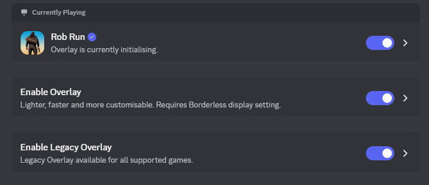

# Discord Setup

This page assists users who require a guide to setup their discord overlay



### Go to your Discord settings

Locate the settings icon at the bottom left of your discord application.



### Find "Game Overlay"

Find the game overlay section and copy these settings.

1. Find game overlay and make sure that **legacy overlay is off**.
2. Find **Enable overlay** and enable the new overlay.
3. Make sure that the new overlay is enabled on whatever game you are planning on using Ascendency on.

<figure><figcaption></figcaption></figure>

1. Head to **System** and enable hardware acceleration.

<figure><figcaption></figcaption></figure>


Make sure that you see the discord overlay is initialized before trying to press "OK" in the menu / lobby.

1. Wait up to a minute or until you see the discord overlay pop up on your screen.
2. For the new discord overlay to show you must be in **windowed full screen**.



